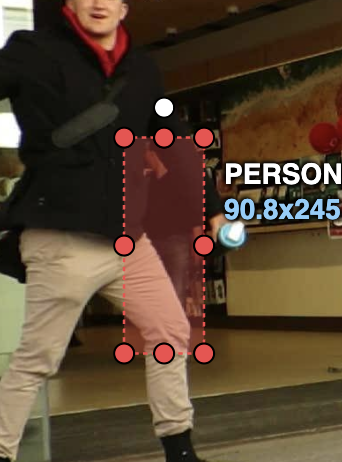
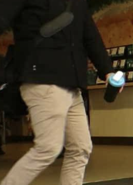
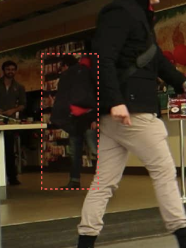

# Báo cáo cá nhân — HoVaTen-MSSV

Đổi tên file theo quy tắc `MSSV_HoTen.md`. Ví dụ: `20241234_NguyenVanAn.md`.

Đoạn video: MOT17-09, 150 frame (frame 1–150), nguồn MOTChallenge, giấy phép CC BY-NC-SA 3.0.

## 0. Thông tin học viên

- Họ tên: Hoàng Quảng Quyền
- MSSV: 2A202603082
- Mã đề (A/B/C): B
- Email: 26ai.quyenhq@vinuni.edu.vn
- Link repository: https://github.com/quyenhoang0712/K5-L2-DAY05-HoangQuangQuyen-2A202603082-MOTTracking
- Giờ bắt đầu: 17:20
- Giờ kết thúc: 18:30

## 1. Xem trước đoạn video (CP0)

Ghi **trước khi vẽ**, mỗi người một dòng.

| Mã | Frame xuất hiện | Frame cuối thấy được | Rẽ / dừng / đổi tốc độ ở frame | Bị che ở frame | Ghi chú |
|---|---|---|---|---|---|
| P1 | 0 | 149 | Cần kiểm tra trên CVAT | 39–49 (outside) | Xuất hiện lại, cần kiểm tra ID được giữ liên tục | 

## 2. Keyframe và thời gian (CP1, CP4)

Kết quả kiểm tra từ `src/check_submission.py`:

| Track CVAT | Số keyframe | Số frame có mặt | Keyframe / 100 frame | Thời gian (phút) |
|---|---:|---:|---:|---|
| Track 0 | 96 | 145 | 66.2 | Chưa ghi nhận |
| Track 1 | 145 | 150 | 96.7 | Chưa ghi nhận |
| Track 2 | 99 | 110 | 90.0 | Chưa ghi nhận |
| Track 3 | 45 | 122 | 36.9 | Chưa ghi nhận |
| Track 4 | 35 | 102 | 34.3 | Chưa ghi nhận |
| **Tổng** | **420** | **629** | **66.8** | **Chưa ghi nhận** |

Tổng keyframe / 100 frame có mặt = 420 / 629 × 100 = **66.8**.

Track 1 có số keyframe nhiều nhất (145 keyframe), tương ứng 96.7 keyframe / 100 frame.

Các track 0, 1 và 2 có mật độ keyframe vượt 50/100 frame, cho thấy việc đặt keyframe còn quá dày và cần tiếp tục rà soát để tận dụng nội suy tuyến tính.

Danh sách frame đặt keyframe chi tiết được ghi trong kết quả chạy `check_submission.py`.

## 3. Đoạn bị che (CP2)


Người bị che: `P1` (cần đối chiếu Track MOT 3 với mã người P1–P5)

| Mốc | Frame |
|---|---:|
| Bắt đầu bị che một phần (bật `occluded`) | Cần kiểm tra trên CVAT |
| Mất hẳn (bật `outside`) | 110 |
| Hiện lại (tắt `outside`) | 135 |
| Thấy rõ trở lại (tắt `occluded`) | Cần kiểm tra trên CVAT |

- **Thời gian khuất hẳn:** 25 frame = 0,83 giây.
- **Quyết định:** Giữ cùng ID.
- **Lý do:** Thời gian khuất hẳn là 25 frame, nhỏ hơn ngưỡng 60 frame (2 giây) theo guideline. Trong file xuất, người này tiếp tục sử dụng cùng track ID sau khi xuất hiện lại. Cần kiểm tra thêm ngoại hình, hướng di chuyển và tốc độ trên CVAT để xác nhận việc nối track là chính xác.

**Ảnh minh chứng:**





 :


## 4. Tự review ID (CP3)

### Kết quả kiểm tra

Đã chạy `src/check_submission.py` để kiểm tra dữ liệu MOT và CVAT. Kết quả ghi nhận 5 track hợp lệ, 0 lỗi định dạng và 3 cảnh báo về mật độ keyframe.

| Frame | Mã người | Loại lỗi | Mô tả một câu | Phát hiện ở lượt | Đã sửa? |
|---:|---|---|---|---|---|
| — | Chưa đối chiếu | Chưa xác nhận | Chưa có lỗi ID cụ thể được xác nhận qua review trực quan hai lượt. | Chưa xác nhận | Chưa xác nhận |

### Ba vấn đề phát hiện bằng script

| Track CVAT | Frame liên quan | Vấn đề | Kết quả | Trạng thái |
|---|---|---|---|---|
| Track 0 | 0–148 | Keyframe quá dày, có nhiều đoạn đặt liên tiếp | 96 keyframe, 66.2/100 frame | Cần tối ưu |
| Track 1 | 0–149 | Gần như mỗi frame đều được đặt keyframe | 145 keyframe, 96.7/100 frame | Cần tối ưu |
| Track 2 | 40–149 | Quá nhiều keyframe liên tiếp, chưa tận dụng tốt nội suy | 99 keyframe, 90.0/100 frame | Cần tối ưu |

### Tổng hợp số lỗi ID theo loại

| `id_switch` | `fragmentation` | `lost` | `merge` | `false_track` | `drift` | `flag` |
|---:|---:|---:|---:|---:|---:|---:|
| Chưa xác nhận | Chưa xác nhận | Chưa xác nhận | Chưa xác nhận | Chưa xác nhận | Chưa xác nhận | Chưa xác nhận |

### Lỗi nào chỉ lượt 2 (theo cảnh) mới thấy, lượt 1 (theo người) không thấy? Vì sao?

Hiện chưa xác nhận được lỗi cụ thể chỉ xuất hiện ở lượt 2. Khi kiểm tra toàn cảnh, cần chú ý các trường hợp hai người đi sát nhau hoặc giao nhau vì dễ xảy ra nhầm ID mà việc kiểm tra riêng từng người có thể bỏ sót.

### Nhận xét

Script xác nhận có đúng 5 track, tổng cộng 623 bounding box trong file MOT, 420 keyframe trong file CVAT và 0 lỗi định dạng.

Ba cảnh báo cho thấy mật độ keyframe còn cao. Cần giảm keyframe không cần thiết ở đoạn chuyển động đều, đồng thời giữ keyframe tại những vị trí đổi hướng, đổi tốc độ và che khuất.

Kết quả script chưa đủ để kết luận không có lỗi ID; phần này cần được xác minh khi xem lại video trong CVAT.

## 5. File xuất và kết quả tự kiểm (CP4)

| Kiểm tra | Kết quả |
|---|---|
| Tên file MOT 1.1 | `HoangQuangQuyen_mot.zip` |
| Tên file CVAT for video 1.1 | `HoangQuangQuyen_cvat_video.zip` |
| Số track ID khác nhau trong `gt/gt.txt` | 5 — Đạt |
| Frame `outside` không có dòng trong `gt.txt` | Đúng theo kết quả kiểm tra đoạn vắng |
| Job đã completed trên CVAT máy cá nhân | Chưa xác nhận trạng thái |

**Tóm tắt kết quả từ `src/check_submission.py`:**

```text
MOT 1.1:
Số track ID: 5
Tổng số box: 623
[OK] Đúng 5 track ID.

CVAT for video 1.1:
Số track: 5
Tổng keyframe: 420
Tổng frame có mặt: 629
Keyframe / 100 frame: 66.8

Tóm tắt:
Lỗi: 0
Cảnh báo: 3
[OK] Đọc được 5 track từ annotations.xml.
```

**Nhận xét:**

Hai file xuất đều đọc được, có đúng 5 track và không phát hiện lỗi định dạng.

Có 3 cảnh báo tại Track 0, Track 1 và Track 2 do mật độ keyframe vượt ngưỡng 50 keyframe / 100 frame. Việc đặt keyframe còn dày, chưa tận dụng hiệu quả nội suy tuyến tính.

Số box trong MOT là 623, trong khi file CVAT ghi nhận 629 frame có mặt. Cần tiếp tục đối chiếu hai bản xuất để xác định nguyên nhân chênh lệch.

Script không có ground truth nên chưa thể kết luận tính chính xác của ID hay bounding box.
```

## 6. Ba câu kết

**1. Nếu được gán lại, bạn sẽ đặt keyframe khác ở đâu? Vì sao?**

Nếu được thực hiện lại, em sẽ giảm số keyframe tại các đoạn người di chuyển thẳng và có tốc độ tương đối ổn định, đặc biệt ở Track 0, Track 1 và Track 2.

Kết quả tự kiểm cho thấy Track 1 có 145 keyframe trên 150 frame, tương đương 96.7 keyframe / 100 frame. Đây là mật độ quá cao.

Em sẽ ưu tiên đặt keyframe tại các vị trí người đổi hướng, thay đổi tốc độ, thay đổi kích thước bounding box hoặc bị che khuất. Cách này giúp tận dụng nội suy tuyến tính, tiết kiệm thời gian gán nhãn và tránh các chỉnh sửa không cần thiết.

**2. Có chỗ nào bạn không chắc "cùng ID hay ID mới"? Bạn đã quyết định và ghi chú thế nào?**

Tình huống cần cân nhắc là khi người đang được theo dõi bị che khuất rồi xuất hiện trở lại.

Trong kết quả MOT có hai đoạn `outside`: frame 39–49 (11 frame) và frame 110–134 (25 frame). Cả hai đều ngắn hơn ngưỡng 60 frame, tương đương 2 giây.

Ở các đoạn này, dữ liệu xuất giữ cùng track ID khi người xuất hiện trở lại. Tuy nhiên, em vẫn cần đối chiếu ngoại hình, hướng di chuyển và vị trí trên CVAT để xác nhận quyết định giữ ID là phù hợp.

**3. Một lỗi ID có thể làm xe tự lái dự đoán sai chuyển động như thế nào? Lỗi đó ảnh hưởng MOTA hay IDF1 nhiều hơn?**

Một lỗi nguy hiểm là `id_switch`, khi hệ thống đang theo dõi người A nhưng lại chuyển sang người B mà vẫn sử dụng cùng ID.

Ví dụ, nếu người A đang đi về phía trước nhưng ID chuyển sang người B đi hướng khác, hệ thống có thể tính sai vận tốc, hướng di chuyển và quỹ đạo tương lai. Trong bài toán xe tự lái, điều này có thể khiến hệ thống dự đoán sai nguy cơ va chạm với người đi bộ.

Lỗi `id_switch` ảnh hưởng trực tiếp đến cả MOTA và IDF1. Tuy nhiên, IDF1 thể hiện rõ hơn hậu quả của việc duy trì sai danh tính qua nhiều frame, trong khi MOTA chủ yếu tổng hợp FN, FP và số lần đổi ID.

Đây là ví dụ phân tích lỗi ID; script hiện tại chưa xác nhận có lỗi `id_switch` cụ thể trong bài của em.

## Bonus (nếu làm)

### B1 — Hai người đi sát

...

### B2 — So cách đặt keyframe

| Cách đặt | Số keyframe | Frame trôi nhất | Ghi chú |
|---|---:|---:|---|
| Đều mỗi 30 frame | | | |
| Theo chỗ đổi hướng | | | |

...

### B3 — So với tracker có sẵn

| Frame | Mã người | Tracker làm gì | Nhãn của bạn | Giải thích (đoán rồi sửa / ghép IoU / box score thấp / ngoại hình) |
|---:|---|---|---|---|
| | | | | |
| | | | | |

## 7. Tài liệu tham khảo và công cụ AI đã dùng
Day-05-lythuyet
...
